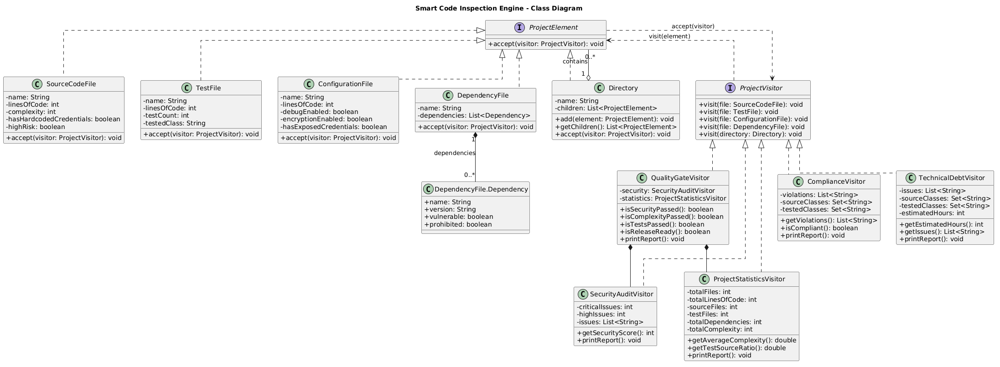
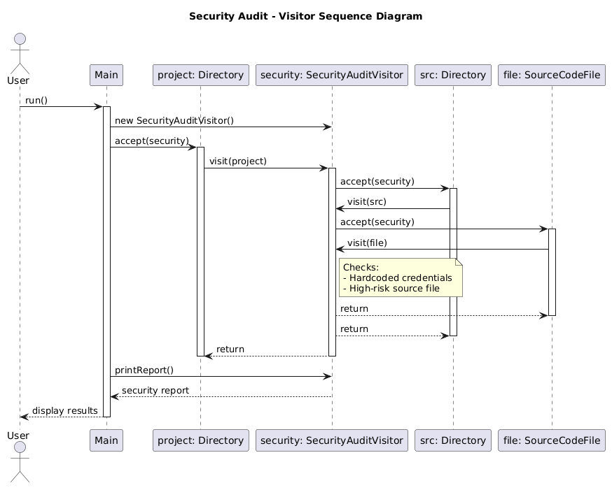

# Smart Code Inspection & Compliance Engine

**Assignment 6 - Visitor Design Pattern**

**Language:** Java 21  
**Build Tool:** Maven  
**Testing:** JUnit 5  
**Design Pattern:** Visitor

## 1. Project Overview

The Smart Code Inspection & Compliance Engine is a Java application that analyzes software project structures using the Visitor Design Pattern.

The system represents different project elements, including source code files, test files, configuration files, dependency files, and directories.

Different Visitors inspect these elements to perform security auditing, statistics calculation, quality checks, compliance validation, and technical debt estimation.

The main purpose is to separate project data from the operations performed on it.

New inspection operations can be introduced without modifying existing element classes.

## 2. Design Pattern - Visitor

The Visitor Pattern allows different operations to be performed on a group of related objects without adding those operations directly to the objects themselves.

In this project:

- `ProjectElement` defines the `accept()` method.
- Five concrete element classes represent project files and directories.
- `ProjectVisitor` defines overloaded `visit()` methods.
- Five concrete Visitors implement different inspection operations.

Each element calls `visitor.visit(this)` inside its `accept()` method.

This demonstrates **double dispatch**, where the selected operation depends on both the concrete element type and the concrete Visitor implementation.

The implementation does not use `instanceof` or large type-checking switch statements.

## 3. Project Structure

```text
sdp_assignment6/
├── src/
│   ├── main/java/com/inspection/
│   │   ├── element/
│   │   │   ├── ProjectElement.java
│   │   │   ├── SourceCodeFile.java
│   │   │   ├── TestFile.java
│   │   │   ├── ConfigurationFile.java
│   │   │   ├── DependencyFile.java
│   │   │   └── Directory.java
│   │   ├── visitor/
│   │   │   ├── ProjectVisitor.java
│   │   │   ├── SecurityAuditVisitor.java
│   │   │   ├── ProjectStatisticsVisitor.java
│   │   │   ├── QualityGateVisitor.java
│   │   │   ├── ComplianceVisitor.java
│   │   │   └── TechnicalDebtVisitor.java
│   │   └── Main.java
│   └── test/java/com/inspection/
│       └── VisitorTest.java
├── uml/
│   ├── class-diagram.puml
│   ├── class-diagram.png
│   ├── sequence-diagram.puml
│   └── sequence-diagram.png
├── pom.xml
└── README.md
```

## 4. Element Hierarchy

All project elements implement the `ProjectElement` interface.

| Element | Purpose |
|---|---|
| `SourceCodeFile` | Stores source file information, complexity, and security flags |
| `TestFile` | Stores test file information and the tested class |
| `ConfigurationFile` | Stores configuration settings and security flags |
| `DependencyFile` | Stores dependencies, versions, and vulnerability information |
| `Directory` | Contains files and nested directories |

The `Directory` class stores a list of `ProjectElement` objects, allowing recursive traversal of the project structure.

## 5. Implemented Visitors

### 5.1 SecurityAuditVisitor

Detects security problems, including:

- Hardcoded credentials
- Vulnerable dependencies
- Exposed configuration credentials
- Debug mode enabled
- Disabled encryption
- High-risk source files

The security score starts at 100.

Each critical issue subtracts 20 points, and each high-severity issue subtracts 10 points. The minimum score is 0.

### 5.2 ProjectStatisticsVisitor

Calculates:

- Total files
- Source files
- Test files
- Lines of code
- Total dependencies
- Average source complexity
- Test/source ratio

**Average complexity:**

`Total source complexity / Number of source files`

**Test/source ratio:**

`Number of test files / Number of source files`

If there are no source files, the calculated values are returned as 0 to avoid division by zero.

### 5.3 QualityGateVisitor

Checks whether the project is ready for release.

| Criterion | Requirement |
|---|---|
| Security | 0 critical issues |
| Average complexity | ≤ 10 |
| Test/source ratio | ≥ 0.40 |
| Source files | At least 1 |

All conditions must pass for the final result to be `PASSED`.

This Visitor reuses `SecurityAuditVisitor` and `ProjectStatisticsVisitor` to avoid duplicating calculations.

### 5.4 ComplianceVisitor

Checks development and business rules:

- No exposed credentials
- Dependency versions must be specified
- Production classes should have tests
- Prohibited dependencies are not allowed

The Visitor collects source class names and tested class names, then compares them to identify missing tests.

### 5.5 TechnicalDebtVisitor - Additional Visitor

Estimates maintenance work using predefined rules.

| Problem | Estimated Work |
|---|---|
| Complexity greater than 10 | 2 hours |
| High-risk source file | 3 hours |
| Missing tests | 2 hours |
| Debug mode enabled | 1 hour |
| Vulnerable dependency | 2 hours |

The estimated hours are illustrative values for the demonstration.

**This Visitor was added in a separate Git commit without modifying the existing element classes or the `ProjectVisitor` interface.**

This demonstrates the main advantage of the Visitor Pattern: adding new operations without changing the existing element structure.

## 6. Fintech Project Demo

The application creates the following simulated project structure:

```text
fintech-project/
├── src/
│   ├── PaymentService.java
│   ├── UserService.java
│   └── utils/
│       └── ValidationUtils.java
├── tests/
│   └── PaymentServiceTest.java
├── config/
│   └── application.properties
└── pom.xml
```

The structure is represented by Java objects rather than actual files read from disk.

All five Visitors process the same project structure.

Nested directories are handled recursively using `accept()` and `visit()`.

The demo intentionally includes security, quality, and compliance problems to demonstrate the inspection engine.

## 7. Example Results

### Security Audit

```text
Critical issues: 3
High issues: 3
Security score: 10/100
```

### Project Statistics

```text
Total files: 6
Source files: 3
Test files: 1
Lines of code: 560
Dependencies: 3
Average complexity: 7.33
Test/source ratio: 0.33
```

### Quality Gate

```text
Security: FAIL
Complexity: PASS
Tests: FAIL

FINAL RESULT: FAILED
```

### Compliance Check

```text
Exposed credentials in PaymentService.java
Exposed credentials in application.properties
Missing version: unapproved-library
Prohibited dependency: unapproved-library
Missing tests for UserService
Missing tests for ValidationUtils

Total violations: 6
Compliance: FAIL
```

### Technical Debt

```text
Total debt issues: 6
Estimated work: 12 hours
```

The results show how different Visitors can analyze the same project elements independently.

## 8. UML Diagrams

### Class Diagram

The class diagram shows the `ProjectElement` hierarchy, the `ProjectVisitor` interface, five concrete Visitors, and the relationships between them.



### Sequence Diagram

The sequence diagram demonstrates how `SecurityAuditVisitor` processes a `SourceCodeFile` inside nested directories through `accept()` and `visit()` calls.



The editable PlantUML source files are also available in the `uml` directory.

## 9. Testing

The project uses JUnit 5 and includes **18 meaningful tests**.

Tests cover:

- All five element types
- Security issues and security score
- Project statistics and calculations
- Quality Gate PASS and FAIL scenarios
- Compliance violations
- Missing tests
- Nested directories
- Empty directories
- Technical debt estimation
- Security score lower boundary
- Repeated technical debt calculations

The tests verify actual calculations and expected behavior rather than only checking object creation.

**Expected test result:**

```text
Tests run: 18
Failures: 0
Errors: 0
Skipped: 0

BUILD SUCCESS
```

## 10. How to Run

### Requirements

- Java JDK 17 or newer (developed using Java 21)
- Maven
- IntelliJ IDEA or another Java IDE

### Run the Application

Clone the repository and open it in IntelliJ IDEA.

Run the `Main.java` class located in:

`src/main/java/com/inspection/Main.java`

The application prints reports from all five Visitors.

### Run the Tests

Open the terminal in the project directory and execute:

```bash
mvn clean test
```

To compile the project:

```bash
mvn clean compile
```

## 11. Visitor Limitation Challenge

### What happens if we add DatabaseMigrationFile?

If we introduce a completely new element called `DatabaseMigrationFile`, several parts of the architecture must change.

**Required changes:**

1. Create a new `DatabaseMigrationFile` class implementing `ProjectElement`.
2. Implement `accept(ProjectVisitor visitor)` inside the new class.
3. Add `visit(DatabaseMigrationFile file)` to the `ProjectVisitor` interface.
4. Update every concrete Visitor to implement the new `visit()` method.
5. Add the new element to the demo if needed.
6. Update the UML diagrams and add relevant tests.

The existing five element classes do not need modification.

However, adding a new method to `ProjectVisitor` forces all existing Visitor implementations to support the new element.

Without updating them, the concrete Visitor classes will fail to compile.

**Conclusion:** Visitor makes adding new operations easy, but adding new element types requires changes to the Visitor interface and all concrete Visitors.

This is the main limitation of the pattern.

## 12. Design Pattern Questions

### 1. What problem does Visitor solve in this project?

Visitor separates inspection operations from the project elements.

Instead of implementing security, statistics, compliance, and quality methods inside every file class, we create separate Visitors.

This keeps the element classes focused on representing project data.

### 2. Where are Element and Visitor?

`ProjectElement` is the Element interface, implemented by `SourceCodeFile`, `TestFile`, `ConfigurationFile`, `DependencyFile`, and `Directory`.

`ProjectVisitor` is the Visitor interface, implemented by the five inspection Visitors.

### 3. What is double dispatch?

Double dispatch means that the executed operation depends on two object types: the concrete Element and the concrete Visitor.

First, an element receives a Visitor through `accept()`.

Then the element calls `visitor.visit(this)`, selecting the correct overloaded method for its type.

For example, `SourceCodeFile.accept()` calls `visit(SourceCodeFile)` on the concrete Visitor.

### 4. Why not put all operations directly inside Element classes?

That would make each Element responsible for too many unrelated operations.

Every time a new inspection feature was added, multiple Element classes would need modification.

Visitor keeps these operations separate, making the system easier to extend and maintain.

### 5. Is it easier to add a new Visitor or a new Element? Why?

Adding a new Visitor is easier.

We only create a new class implementing `ProjectVisitor`. Existing Element classes remain unchanged.

Adding a new Element requires extending `ProjectVisitor` and updating every concrete Visitor.

### 6. When would Visitor be a bad choice?

Visitor is less suitable when new element types are added frequently.

Every new element requires changes across all concrete Visitors, increasing maintenance work.

It is more suitable when the element hierarchy is relatively stable but new operations are added often.

### 7. How is Visitor different from Strategy?

**Strategy** allows an object to switch between different algorithms for the same task.

**Visitor** allows different operations to be performed on a structure containing multiple element types.

Strategy focuses on interchangeable behavior, while Visitor focuses on separating operations from a fixed object structure.

### 8. Which SOLID principles can you identify?

**Single Responsibility Principle (SRP):** Each Visitor handles one main inspection responsibility.

**Open/Closed Principle (OCP):** New Visitors can be added without modifying existing Element classes.

**Dependency Inversion Principle (DIP):** Elements depend on the `ProjectVisitor` interface instead of specific concrete Visitors.

**Interface Segregation Principle (ISP):** Visitor also demonstrates a limitation here: all concrete Visitors must implement methods for every element type, even if some methods are empty.

## 13. Git Development History

The project was developed incrementally with meaningful Git commits.

Main development stages include:

1. Maven project initialization
2. Element hierarchy and Visitor interface
3. Security Audit Visitor
4. Project Statistics Visitor
5. Quality Gate Visitor
6. Compliance Visitor
7. Additional Technical Debt Visitor
8. Complete fintech demo with nested directories
9. JUnit 5 tests
10. UML diagrams and documentation

The additional Visitor was introduced in a separate commit, demonstrating extension without changing existing Element classes.

## 14. Conclusion

This assignment demonstrates the Visitor Design Pattern through a Smart Code Inspection & Compliance Engine.

The application supports five element types and five inspection Visitors, including security auditing, statistics, quality checks, compliance validation, and technical debt estimation.

The implementation demonstrates double dispatch, recursive directory traversal, separation of responsibilities, and extensibility without type-checking statements.

The project also includes JUnit 5 tests, UML diagrams, and incremental Git development.

The main lesson is that Visitor is useful when operations change frequently while the element structure remains relatively stable.